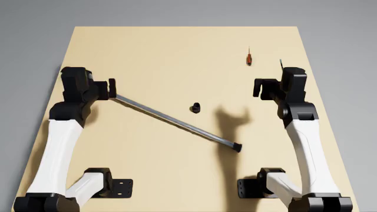
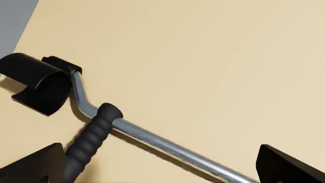
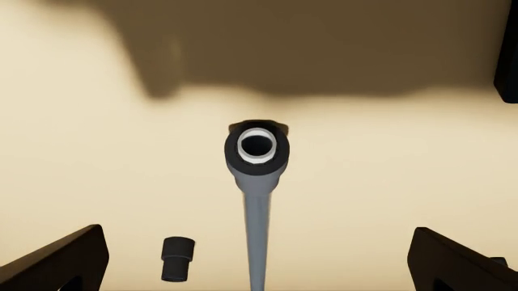

# Prepare a crutch for reuse

Two independent complete scripted trials scored 1.0 in 1,627 control steps each under the final observer, including indirect robot support through loose objects. Matching fit, release and contact controls produced their expected scores.

The full-size forearm crutch has a worn-through rubber foot. Its metal tube projects 4 mm beyond the remaining sole. The replacement is a matching 22 mm push-fit rubber foot, standing separately on its sole on the bench. The instruction is: “Prepare this crutch for its owner.”

This is a fitting and retention task. It does not model a patient, certify a load rating, or demonstrate patient weight-bearing strength. The scripted demonstration must physically remove the damaged foot, fit the new foot against its sole, show it remains attached while unsupported, and leave the crutch on the bench with both grippers clear.

## Importance and sources

Replacing a worn rubber foot is a specified crutch maintenance operation. South Tees Hospitals NHS Foundation Trust includes regular crutch checks and replacement of worn or split ferrules in its patient safety guidance. [South Tees: How to use elbow crutches](https://www.southtees.nhs.uk/resources/how-to-use-elbow-crutches/).

Aidapt's replacement-ferrule instructions describe pulling off the existing foot, keeping the mating surfaces clean and dry, and pushing the replacement fully onto the base; slight twisting may assist removal and fitting. The task evaluates that complete operation on a freely handled, full-size aid. [Aidapt replacement-ferrule instructions, page 2](https://media.supplychain.nhs.uk/media/documents/GVV021/Marketing/72905_GVV021.pdf). The simulation measures fit and retention under the foot's own weight; it does not demonstrate patient-load strength.

## Reproduce the scene

The bench top is z=0.7475 m. The complete crutch is 900 mm long, with a 22 mm aluminum shaft, polymer handgrip and cuff. Its mass without its foot is 0.388579 kg. Its starting native axis points along world (0.4, 0.916515, 0); its native origin is (0.15, -0.24, 0.792) m and it settles onto its side on the bench.

The healthy rubber foot is 45 mm high, 38 mm maximum outside diameter, 30 mm upper outside diameter, and 50 g. Its sole is 8 mm thick. Its origin starts at (0.35, -0.05, 0.7477) m with its bore vertical and mouth upward. The damaged foot is 42 g and initially fitted; its bottom 12 mm is missing, exposing the tube end at native z=8 mm. Both feet are separate physical assemblies with open bores. Neither is attached to the shaft by a joint.

Two loose distractors lie outside the repair path: a 109 × 8 × 7 mm blue plastic marker, 8 g, at (0.60, -0.50, 0.7475) m; and a 148 × 27 × 26 mm slotted screwdriver, 36.47 g, at (0.65, -0.35, 0.7475) m. Positions refer to asset origins, in metres. Neither has an independent placement goal. Their physical contacts still matter when checking that the repaired assembly is released.

A physical reconstruction uses an ordinary full-size 22 mm forearm crutch, its matching dry replacement rubber ferrule, a worn-through ferrule, and an ordinary bench. The synthetic crutch mesh is not manufacturer CAD. The dimensioned reconstructed foot follows its source envelope; the fitting mechanism and obtainable 22 mm size are supported by the manufacturer references below.

## Setup and optional inspection



The initial overhead view shows the fixed starting object layout. The initial left wrist view below shows the cuff and handgrip; it supplements the overhead image.



The initial overhead setup image records the fixed layout. The exposed tube is on the underside of the worn foot and is not clearly resolved in that overhead image. An ordinary noncontact movement of the existing right wrist camera reveals it, as the supplemental inspection image shows. The camera moved; the objects were neither touched nor disassembled, and their post-settle drift was below 0.08 mm. Inspection is optional and does not add a prescribed action sequence to scoring.



## Mechanism and fidelity

The original source has a fixed solid tip. The task removes that tip and reconstructs an open rubber foot. The original shaft ends inside the solid tip at native z=30 mm; a same-diameter tube extension reaches z=8 mm, at the reconstructed seating stop. Its 2 mm wall thickness is estimated. No grip tab, invisible clamp, enlarged access opening or scaled-down crutch is introduced.

Twelve full-depth radial sectors approximate rubber compression. Each full-depth sector moves radially, with the same displacement along its length, with mass 1.5 g, stiffness 20,000 N/m, damping 3 N s/m, force cap 80 N, and travel bounds -0.5 to +1.5 mm. This coarse axial coupling omits local variation in compression; it avoids independent axial segments whose mismatched expansion would create artificial ledges. Their free inner planes lie at radius 10.8 mm around the 11 mm shaft, giving nominal 0.2 mm compression and approximately 48 N total normal reaction. An entry bevel opens to radius 11.7 mm over the upper 5 mm. Rubber static/dynamic friction is 0.8/0.65; shaft friction is 0.45/0.35. These properties are disclosed estimates, not fitted manufacturer test data.

The worn foot has a free bore radius of 10.98 mm. Small convex colliders use vertices enlarged 1,000 times under a 0.001 transform scale, preserving physical dimensions while conditioning mesh cooking.

The lower shaft uses two collinear analytic cylinders on the same rigid body: native z=8–68 mm and z=68–500 mm, both radius 11 mm. Their union equals the original lower shaft envelope, and the internal seam lies 23 mm above the ferrule mouth when seated. This representation avoids a spurious mouth impulse observed with one long cylinder. Native mass and center of mass are unchanged; the inertia comparison differs only by floating-point roundoff. The full 900 mm crutch remains present.

Each radial sector uses one convex collider with continuous planar wall and entry faces; the rigid outer shell retains its visual shape. Continuous circumferential deformation, local axial deformation, tread deformation and rubber hysteresis are approximated. The convex sector is a subset of the earlier overlapping wall/bevel boxes: it clips 12.07 mm³ per sector from the outer bevel protrusion enclosed by the rigid shell. Every inner wall, entry bevel and sole contact plane is preserved, together with explicit mass, inertia, spring, damping, travel and material parameters. This removes an internal collider face at the bevel/wall join; it is not exact-union equivalence. Axial insertion ends through contact with the actual sole collider. Retention comes from contact friction; there is no snap, attachment latch, proximity-triggered force or success-conditioned joint.

A read-only replay of the unchanged policy measured 984 unique physics samples during the shared tilt. Five isolated 2.083 ms samples produced simultaneous opposing finger reactions of approximately 950 N per jaw. These are contact reactions, not validated physical grip loads; a small combined resultant does not remove the opposing loads. Separate authored collision hulls (45 and 47 pieces for the two fingers), saved native joint positions and shaft transforms, and neighboring samples reconstruct at most 0.099 mm overlap, whereas the contact reports reach 1.47 mm. This supports a rigid-contact manifold correction, with limits: the calculation uses authored hulls rather than a direct cooked-hull query, and contact reports can precede the saved post-solver poses. The rigid shaft has no deformation, denting or crushing model. Neither native actuator limits nor this diagnostic certify aluminum strength.

A person can check the completion with a ruler, angle gauge and short video: confirm the worn foot is detached and set aside; use a reference mark 37 mm from the tube end to check seating within 2 mm (the 45 mm foot has an 8 mm sole) and its bore axis aligns within 3 degrees; tilt the shaft upward at least 60 degrees while keeping the foot at least 25 mm above the bench and untouched for 1.5 seconds. Position marks must move no more than 3 mm or 3 degrees during that window. Then lay the crutch on its side with both foot and cuff resting on the bench, clear all hands, and observe one second of the same stability. The simulator's 0.0001 N contact threshold is only its numerical-zero tolerance; a physical observer checks that nothing touches or supports the foot during retention and that the repaired assembly is released, with no direct robot contact or contact through robot-held loose objects. This retention check tests the foot's own weight, not patient loading.

The scorer uses geometric measurements, bounded pose windows, gripper clearance, and read-only contact observations at every physics step. The scripted controller reads object poses and contact reactions to correct ordinary robot TCP commands; it never moves objects or writes their joint state. Model agents do not receive the scripted controller's state observations.

## Sources and licenses

- [NVIDIA USDCraft-10K](https://huggingface.co/datasets/nvidia/USDCraft-10K/tree/6fbffb56c443237ddae9f6c7a05b72263fd1469e), `R486_crutch/02_forearm_crutch`, Apache-2.0. Exact file path and SHA-256 are recorded in `source_asset.json`; `LICENSE-USDCraft` contains the license. Loaded at full scale. The fixed tip is removed, original bodies are combined, lower shaft contact geometry follows the source centerline, and the disclosed tube extension is added.
- [Aidapt ferrule fitting instructions](https://media.supplychain.nhs.uk/media/documents/GVV021/Marketing/72905_GVV021.pdf): remove the old foot, keep the interface clean and dry, and push the matching replacement to its stop, with twisting if needed.
- [Aidapt catalogue](https://static.electrovision.co.uk/downloads/publications/aidcat23up/aidcat23up.pdf), printed page 100: VS101P supports the obtainable 22 mm fitting size. This is not a claim that the reconstructed foot is exact VS101P CAD.
- [NHS falls-prevention guidance](https://notts.icb.nhs.uk/wp-content/uploads/sites/2/2022/04/Falls-in-Care-Homes-Best-Practice-Guidelines.pdf): worn ferrules increase the risk of slipping and falls (page 9).
- [SimReady blue marker](https://huggingface.co/datasets/nvidia/simready-assets/tree/9d4556bfe80868c1d27a7a7ba1c2774e63e8cedd/stationery_marker_thin_blue_a01), © NVIDIA, CC-BY 4.0. Full scale; mass set to 8 g; invisible grasp annotations removed.
- [SimReady slotted screwdriver](https://huggingface.co/datasets/nvidia/simready-assets/tree/9d4556bfe80868c1d27a7a7ba1c2774e63e8cedd/handTool_screwdriver_slotted_4mm_a01), © NVIDIA, CC-BY 4.0. Full scale and authored mass; invisible grasp annotations removed.

Assets download into the local cache on first use. The included `mechkit.py` and `simready.py` derive from the shared mechanism kit and open-source benchmark loader. The scene uses 480 Hz physics and 20 Hz control, with a fixed layout and zero object jitter.

## Run and score

```bash
source ~/IsaacLab-Arena/yam.env
inspect-robots run --embodiment yam_arena --policy yam_scripted \
  -E task=tasks/replace-worn-crutch-ferrule/task.py -E object_jitter=0 \
  -E control_hz=20 -E cam_width=640 -E cam_height=360 \
  --instruction 'Prepare this crutch for its owner.' \
  --scorer task_score --max-steps 1680 --store-frames
```

One trial permits 1,680 control steps, 84 seconds of simulated time. Both complete demonstrations reached full score in 1,627 steps (81.35 simulated seconds). Their recorded wall durations were 3921.3 and 3916.9 seconds (65.4 and 65.3 minutes) with concurrent GPU trials. The layout is fixed: configured seed 0, recorded trial seed 1415158438. The canonical entry is task.py.

Dream-1 (`dreamlabs/dream-1-beta`) completed all 1,680 control steps with score 0.0, in 1,747.9 seconds of wall time (29.1 minutes), using the same fixed layout and seeds. To reproduce the model trial, replace `--policy yam_scripted` with `--policy dream` in the command above. The submitted demonstration places the original overhead recording beside the supplementary foot recording, aligned by control step.

The scorer returns 0 otherwise, 0.5 for removal plus correctly seated replacement and observed unsupported retention, and 1.0 when the repaired assembly is also released and settled on the bench. Exact dimensions, clearances, allowed pose drift and reset conditions are listed in task.json. The read-only contact observer checks all 13 replacement-foot rigid bodies and the crutch against external bodies at 480 Hz, including individual normal and friction contacts. Each 20 Hz observation must contain all 24 physics samples plus its boundary sample. Unsupported retention excludes every external support; final release excludes direct contact with all 18 robot bodies and any contact path through the old foot, marker or screwdriver to a robot. The old foot’s 12 unbreakable joints connect its 13 bodies for this check. Paths stop at fixed bench and room supports, so a robot holding an unrelated object on the same bench does not invalidate release. A second 15-body contact view measures the loose objects at every physics sample; it does not infer contacts from proximity. Contact ranges, count integrity and buffer capacity are checked before use.

The scripted robot controller measures both shaft-to-gripper transforms after grasping and commands both gripper targets with a common rigid transform. It holds the observed bore frame fixed and applies bounded shared corrections in free space before entering. The ordinary bench supports the loose ferrule during insertion. To account for loaded arm tracking, the controller can add a common axial target correction of up to 40 mm, at no more than 0.25 mm per control interval; total axial target change stays below 0.5 mm per interval. Correction pauses at 40 N measured foot reaction. Above 45 N the target retreats until reaction falls below 35 N; these are measured feedback thresholds. Joint, effort, grasp, contact and command-rate guards prevent accumulated correction when motion is obstructed. After the slow twist, a measured attitude correction can rotate the complete two-gripper target about the commanded shaft tip by up to 2°, at no more than 0.025° per control interval. It requires a fresh full physics interval with liner engagement and no fixed-frame contact. Axial correction pauses during attitude updates and still requires actual shaft/bore alignment within 1°. The angular correction fades out during return. The seating dwell includes four seconds for the measured final insertion travel; the complete scripted plan is 82 seconds within the 84-second limit. This changes robot position targets only. This is an allowed route: there is no requirement to pick up the spare, use two arms, twist, or follow the scripted sequence if another physical repair satisfies the same score.

A supplementary fixed camera records the ferrule during the unsupported check. It does not change policy observations or camera bodies. The two full demonstrations start with the worn foot fitted and the replacement separate, and show complete removal, replacement, unsupported retention and released return. Component controls are separate: a matched pre-fitted assembly scores 1.0 after release and 0.5 when still held; an oversized foot falls free and scores 0.0. Idle and a right-arm-only removal attempt score 0.0. Bench, forearm, indirect worn-foot support and disconnected-support calibrations also score 0.0 while producing the expected native contact witnesses. None of those component controls is counted as a full repair.

Set `FERRULE_AUDIT_IMAGES` to a distinct directory for each concurrent trial to preserve its supplemental PNG frames. The default is `/tmp/ferrule-retention-audit`.
